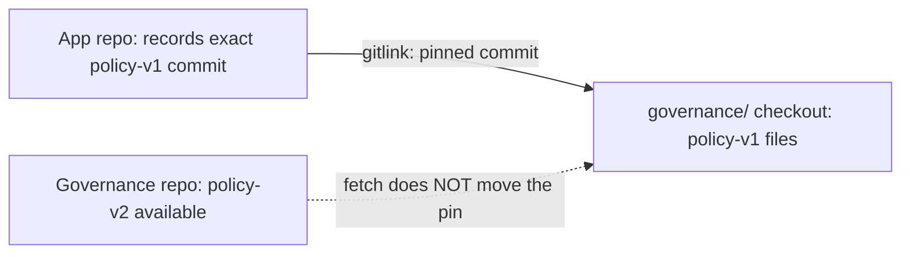

# Submodules, without the magic 🌱

A tiny Gleam app and shared governance docs. Start here, then follow the
[5-minute walkthrough](docs/WALKTHROUGH.md) or the
[explain-like-I’m-10 guide](docs/EXPLAIN-LIKE-10.md).

## The entire idea

**A submodule is another Git repo inside your repo, pinned to one exact commit.**
Updating the shared repo does not change the app until someone reviews and
commits a new pointer in the app. Git provides the mechanism, not automatic
policy enforcement.

```text
~/code/
├── submodule-demo-governance/       independent repo: policy-v1 → policy-v2
└── submodule-demo-gleam/            independent app repo
    ├── src/                       tiny Gleam app
    ├── .gitmodules                where to get governance
    └── governance/                submodule pinned to policy-v1
                                   (v2 exists, but is not adopted yet)
```



## Try it safely

```sh
cd ~/code/submodule-demo-gleam
./scripts/rehearse.sh
```

The rehearsal creates temporary clones, demonstrates adoption of v2 and rollback
to v1, and verifies each step. It does **not** change either source repo. It
prints the temporary directory and leaves it available for inspection. Both demo repositories are public, so no GitHub login is required to clone.

## Run the app

With Gleam and Node installed:

```sh
gleam run --target javascript
gleam test --target javascript
gleam format --check src test
```

This deliberately uses the JavaScript target, so Erlang is not needed. Gleam
fetches its declared packages on first run. Gleam 1.19.2 and Node 26.0.0 were used to compile, run and test this demo.
See [verification](docs/VERIFICATION.md).
The application is deliberately independent of the docs at runtime: governance
is a development dependency, not something it downloads when starting.

## Everyday command summary

| Goal | Command (from app root) |
| --- | --- |
| Initialise a normal remote clone | `git submodule update --init --recursive` |
| See recorded and checked-out versions | `git submodule status` and `git ls-tree HEAD governance` |
| Fetch available governance versions | `git -C governance fetch origin --tags` |
| Choose a reviewed version | `git -C governance checkout --detach policy-v2` |
| Review the app pointer change | `git diff --submodule=log` |
| Record the choice in the app | `git add governance && git commit -m "Adopt governance v2"` |
| After pulling a teammate’s app update | `git submodule update --init --recursive` |
| Roll back | Select `policy-v1`, then commit the pointer again |

The governance submodule uses a standard HTTPS GitHub URL. No local-file
protocol override or global Git security setting is needed.

## What Git actually stores

- `.gitmodules`: submodule path and clone URL. Here it is a cloneable HTTPS GitHub URL.
- A **gitlink** (mode `160000`): the selected governance commit ID in the app tree.
- The governance repo owns its files and history. The app records the commit,
  not an ordinary copied directory of those files.
- The submodule normally has a detached HEAD. That is expected for a pinned
  dependency; create a branch there before authoring new policy work.

## For a team with 20 repositories

Use a bot to open an **update PR** in each consumer when a governance version is
released. Review and merge deliberately. CI can initialise submodules and check
the pin against an approved minimum version. This balances reliable builds with
not relying on every developer to remember updates. No custom pull hook needed.

Submodules do **not** auto-update, grant access, enforce the written policy, or
make an unpushed commit available to teammates. Publish policy commits **before**
publishing app pointers that refer to them. Avoid `git submodule update --remote`
in ordinary builds: it selects a moving remote branch instead of the app's pin.

## Sharing this demo

Both repositories are **public** on GitHub:

- [Governance policy](https://github.com/spik3r/submodule-demo-governance)
- [Gleam application](https://github.com/spik3r/submodule-demo-gleam)

Share these links directly. Your friend can read and clone both repositories
without a GitHub account. Write access is separate; making a repo public does
not let everyone push changes. Never put a token in `.gitmodules`.

```sh
git clone --recurse-submodules https://github.com/spik3r/submodule-demo-gleam.git
cd submodule-demo-gleam
./scripts/rehearse.sh
```

GitHub displays the governance entry as a link to the pinned commit. A downloaded
ZIP is not equivalent to a recursive Git clone and will not populate submodules.
If you later move the governance repository, update `.gitmodules`, commit it,
and run `git submodule sync --recursive` in existing clones.
