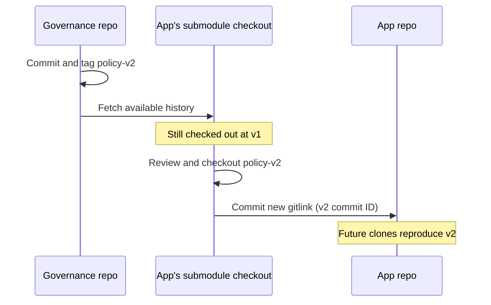

# Five-minute live demonstration

Run each section in the same terminal. These commands create a fresh temporary
app clone, so the original demo stays pinned to v1 for your next presentation.

## 1. Clone the app and its rulebook

```sh
DEMO=$(mktemp -d "${TMPDIR:-/tmp}/submodule-talk.XXXXXX")
git clone --recurse-submodules https://github.com/spik3r/submodule-demo-gleam.git "$DEMO/app"
cd "$DEMO/app"
git config user.name "Submodule Demo"
git config user.email "demo@example.invalid"
cat governance/README.md
git submodule status
```

The app has v1, even though the governance repo already has v2.
For an existing clone that forgot `--recurse-submodules`, use:
`git submodule update --init --recursive`.
You need authenticated read access to both private GitHub repositories.

## 2. Show the pin

```sh
git ls-tree HEAD governance
git -C governance log --oneline --all --decorate
```

`160000 commit <ID> governance` is the app's bookmark. Governance has its own
history. `.gitmodules` is the address book, not the selected version.

## 3. Fetch, review and deliberately adopt v2

```sh
git -C governance fetch origin --tags
git -C governance rev-parse HEAD            # still v1: fetch did not adopt v2
git -C governance diff policy-v1 policy-v2 -- README.md
git -C governance checkout --detach policy-v2
git diff --submodule=log                     # pointer changed, not committed yet
git add governance
git commit -m "Adopt governance policy v2"
```



Two separate commits are involved: publishing policy content, then adopting
that policy in the consuming app. In a real team, review both as PRs.

## 4. Show the gotcha after a teammate updates the app

```sh
git -C governance checkout --detach policy-v1  # simulate stale working files
git submodule status                          # leading + means not at recorded pin
git submodule update --init --recursive
git -C governance describe --tags --exact-match # back to policy-v2
```

`git pull` alone is not a promise that every submodule working tree was updated.
Initialise/update submodules explicitly in setup and CI. Git submodule status
uses a space for the expected commit, `-` for uninitialised and `+` for a mismatch.
Do not reset or force-update a teammate's uncommitted submodule edits.

## 5. Roll back safely

```sh
git -C governance checkout --detach policy-v1
git add governance
git commit -m "Return to governance policy v1"
```

This records a normal, reviewable app history change. It does not delete v2
from governance or rewrite anyone's history.

## If you edit policy inside the app

Create a branch **inside** `governance/`, commit there, and publish that branch
to the governance remote first. Review/merge it there. Then update and commit
the app's pointer. Do not just `git add governance` while its files are uncommitted:
the app cannot record those uncommitted contents in a gitlink.

## Team/CI quick setup (HTTPS or SSH remote)

```sh
git clone --recurse-submodules <app-url>
# or after an ordinary clone / pull:
git submodule update --init --recursive
```

For GitHub Actions, `actions/checkout` supports `submodules: recursive`.
Private governance requires read access as well; an app-repo token does not
automatically grant access to a separate private repository. Keep credentials
out of `.gitmodules`. This demo does not create any hosted workflow or hook.
